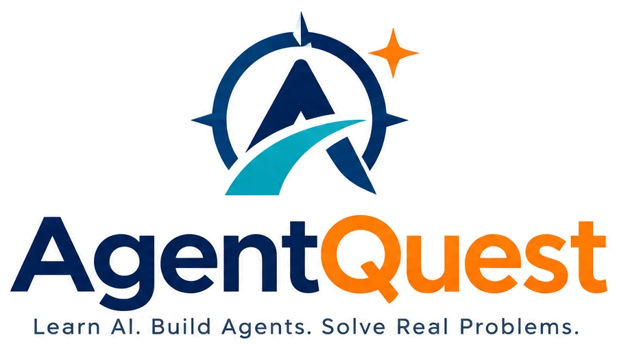
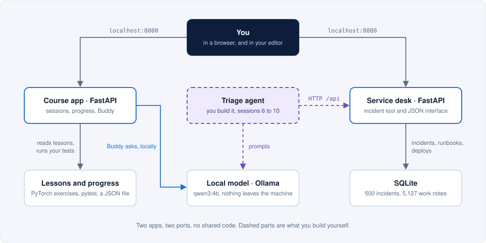
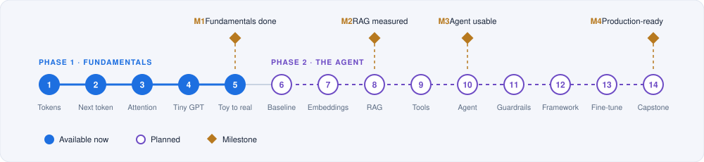

<p align="center">
  <picture>
    <source media="(prefers-color-scheme: dark)" srcset="assets/brand/agent-quest-logo-dark.png">
    
  </picture>
</p>

<p align="center">
  An open-source, hands-on learning environment that takes you from understanding how LLMs work<br>
  to building your first functional AI agent, using a realistic incident management application.
</p>

<p align="center">
  <a href="LICENSE"></a>
  
  
</p>

The setting is a fictional travel company, Time Travel Inc. (flights, hotels,
cruises), with a service desk holding 500 past incidents and an on-call team
that needs help with first-pass triage. Each idea is built once by hand, then
replaced with the standard tool and measured. Everything runs on one machine,
and the built-in assistant, Buddy, uses only a model running locally.

## How it fits together



Everything runs on one machine. The course app and the service desk are two
separate applications that share no code. The triage agent you build in the
later sessions reaches the service desk over HTTP, the way it would reach a
real ticketing system.

## Meet Buddy


**Buddy is the learning sidekick built into the course app.** Ask him what a
session teaches, how much you have done today, what to do next, or anything
about a lesson you have unlocked. He can explain a session, give a hint on the
exercise you are stuck on, walk through a worked example, and quiz you.

<br clear="left">

Buddy is deliberately limited, and that is the point:

- **Local only.** He uses a model running on your machine under
  [Ollama](https://ollama.com). No hosted model, no paid tokens, no internet.
- **He knows this course and nothing else.** Off-topic questions are declined
  without the model being called.
- **Facts are computed, not generated.** Progress, streaks and next steps come
  straight from your progress file.
- **No spoilers.** He never reads worked answers or reference solutions, and
  will not open lessons you have not unlocked.

If Ollama is not running, the factual answers still work and lesson questions
fall back to the lesson's own text.

## Roadmap



| Phase | Sessions | Status |
| --- | --- | --- |
| **1 · Fundamentals** | 1 Tokenization · 2 Predicting the next token · 3 Attention · 4 A tiny GPT · 5 From toy to real | Available now |
| **2 · The agent** | 6 Baseline and measurement · 7 Embeddings for search · 8 RAG · 9 Tool calling · 10 The agent | Available now |
| **2 · The agent** | 11 Guardrails and failure · 12 Framework port · 13 Fine-tuning versus RAG · 14 Capstone | Planned |

Milestones along the way: **M1** fundamentals done (session 5), **M2** retrieval
measured (session 8), **M3** agent usable (session 10), **M4** production-ready
(session 14). Each session unlocks when the one before it is complete.

## Two separate applications

| | Address | What it is |
| --- | --- | --- |
| **Service desk** | `http://localhost:8080` | Time Travel Inc.'s incident management tool: queues of open and resolved incidents, incident records with work notes, a form to raise a new incident, services and runbooks. It also serves a ServiceNow-style JSON interface under `/api`. |
| **Course app** | `http://localhost:8000` | 14 sessions, each with pre-work to watch, a lesson with interactive diagrams, short coding exercises, experiments and homework. It tracks your progress. |

They share no code and no routes. The course app only links to the service
desk, and the triage agent you build talks to the desk over HTTP, like any
other client would.

The desk holds 500 generated incidents (P1 to P4) across 12 services. Each
resolved incident carries a troubleshooting thread of 7 to 15 timestamped
work notes from several people (service desk, on-call engineers, incident
commander, customer support, supplier relations): diagnostics, a first guess
that was ruled out, the cause, the fix, and a closing note with root cause,
fix and follow-up. The
400 oldest are resolved history. The 100 newest sit in the open queue with
no priority, service or resolution, waiting for triage; their correct
answers are kept aside for scoring the agent.

## Getting started

You need Python 3.12 or newer. Everything else is checked for you:

```bash
./setup.sh
```

The script assumes nothing is installed. It works through the list below, sets
up what it can, and asks before each sizeable download:

| Step | What it does | Needed for |
| --- | --- | --- |
| Python environment | Creates `.venv` and installs the core dependencies | Everything |
| Lesson libraries | Asks, then installs PyTorch and Chroma (about 300 MB) | Exercises in sessions 2 to 5; the vector database from session 8 |
| Incident data | Generates the 500 incidents locally | The service desk |
| Ollama | Checks it is installed and running; offers Homebrew on a Mac, else points to [ollama.com/download](https://ollama.com/download) | Buddy's explanations, hints and quizzes; session 5 |
| Local model | Asks, then downloads `qwen3:4b` (about 2.5 GB) | The same, and every experiment from session 5 onward |
| Embedding model | Asks, then downloads `nomic-embed-text` (about 270 MB) | Search, from session 7 |
| Docker | Reports whether it is present | Optional |

To see what is present and what is missing without changing anything, run
`./setup.sh --check` (or `make check`). For an unattended install, `./setup.sh --yes`
answers yes to every question.

Without Ollama the lab still runs: the service desk, the lessons and Buddy's
answers about your progress all work. Only Buddy's lesson explanations and
the experiments from session 5 onward need the local model.

Then start both apps:

```bash
make serve    # course app on http://localhost:8000, service desk on http://localhost:8080
```

Other commands:

```bash
make test            # run the tests
make data            # regenerate the incidents (same data every time)
make setup-lessons   # install PyTorch and Chroma later, if you skipped them
```

To run one app on its own, use `make desk` or `make course`.

With Docker, each app runs in its own container:

```bash
make up       # docker compose up --build
make down
```

## How a session works

1. **Pre-work.** Watch the videos and skim the reading on the session page.
   Videos play in the page and mark themselves done when the segment ends.
2. **Concept.** Read the lesson and try the interactive diagram.
3. **Build.** Open the file named in each exercise, for example
   `lessons/01-tokenization/bpe.py`, and fill the gap marked `YOUR CODE`.
   Press **Run the tests**. An exercise is done when its tests pass; it
   cannot be ticked by hand.
4. **Experiment.** Write your prediction in the page first, then run the
   command shown.
5. **Homework.** A short problem set and design review questions, each with
   a worked answer to compare against.

Reference solutions are in each lesson's `_solution/` folder.

From session 5 the experiments talk to a model running locally under
[Ollama](https://ollama.com) (`qwen3:4b`) and to the service desk, so have
both running. Exercises are run on your machine with `make serve`; the Docker
image for the course app does not include PyTorch or Chroma.

From session 6 every experiment that triages the 100 held-back incidents adds
a row to the results board in the course app, so you can compare the model
alone, a vote among similar incidents, retrieval, and the agent with tools on
the same incidents.

## Checks

Every pull request and every push to `main` runs five checks on GitHub-hosted
runners: Python lint (ruff), Markdown lint, shell lint (ShellCheck), the unit
tests, and a secret scan (gitleaks). The jobs are reusable workflows kept in
[saratrajan/ci-cd-templates](https://github.com/saratrajan/ci-cd-templates).
To run the same checks before pushing:

```bash
make lint
make test
```

The experiments that call a local model are not part of these checks; they
need Ollama and are run by hand.

## Where things are kept

| Path | What |
| --- | --- |
| `data/progress.json` | Your progress and written answers. Delete it to start again. |
| `data/timetravel.db` | The incidents. `make data` rebuilds it and never touches your progress. |
| `data/corpus.txt` | Text of the 400 history incidents, used for training in the fundamentals sessions. |
| `data/eval_labels.json` | Correct answers for the 100 held-back incidents. |
| `servicedesk/` | The service desk application: catalog, incident generator, database, interface and pages. |
| `course/` | The course application. |
| `docker/`, `docker-compose.yml` | One container per application. |
| `docs/` | Roadmap, design and build plans. |

`data/` is not committed; every file in it can be regenerated except
`progress.json`.

## Licence

MIT. See [LICENSE](LICENSE).
